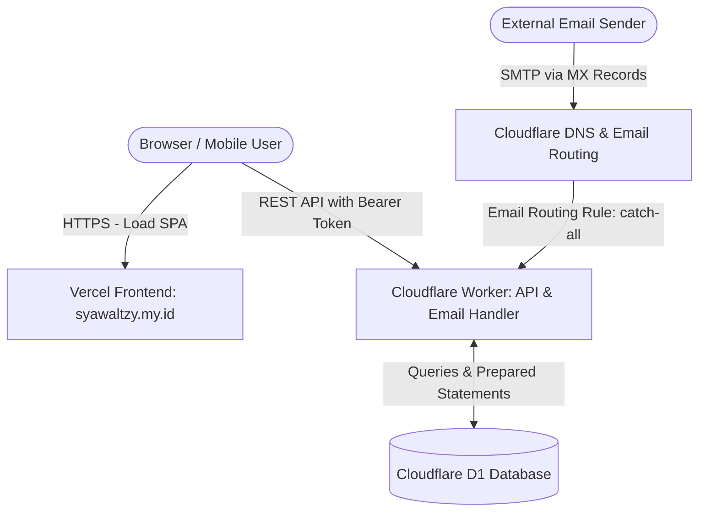

# Syawal TempMail — Architecture & System Design

## 1. Overview
Syawal TempMail (`syawaltzy.my.id`) adalah layanan temporary/disposable email modern, aman, dan tanpa relai keluar. Domain terpisah secara tegas dari domain utama pemilik (`syawaltzy.biz.id`).

## 2. Diagram Arsitektur

## 3. Komponen Sistem

### A. Frontend (Web Application)
- **Framework**: React 18 / 19 with Vite, TypeScript.
- **Styling**: Tailwind CSS, Lucide React icons.
- **Hosting**: Vercel.
- **Fungsi**:
  - Request pembuatan inbox baru via API.
  - Menyimpan `inbox_id` dan `access_token` secara sementara di memory/session storage (bukan raw email).
  - Countdown masa berlaku inbox (default 10 menit).
  - Refresh inbox & polling pintar (berhenti saat tab background/blur).
  - Sanitasi HTML email (Text-first, sanitasi ketat untuk HTML).
  - Ekstraksi dan satu-klik salin OTP.

### B. Cloudflare Worker (Backend API & Email Receiver)
- **Runtime**: Cloudflare Workers (V8 isolates di edge).
- **Dual Responsibility**:
  1. **HTTP Handler (`fetch`)**: Menyediakan REST API dengan autentikasi access token berbasis SHA-256 hash.
  2. **Email Handler (`email`)**: Menerima event dari Cloudflare Email Routing, membaca envelope asli, validasi keberadaan & keaktifan inbox di D1, parsing MIME via `postal-mime`, dan menyimpan pesan.

### C. Database (Cloudflare D1)
- Database SQLite terdistribusi di edge.
- Tabel:
  - `inboxes`: ID, address, token_hash, timestamps, is_active.
  - `messages`: ID, inbox_id, sender, subject, text, sanitized html, extracted_otp, received_at.
- Foreign keys & indexes untuk query performan tinggi.
